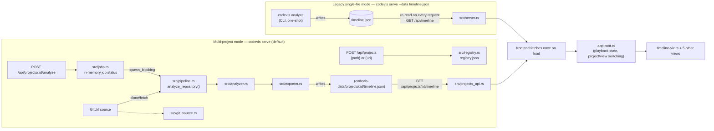
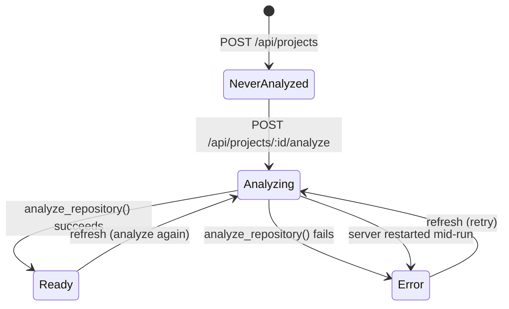
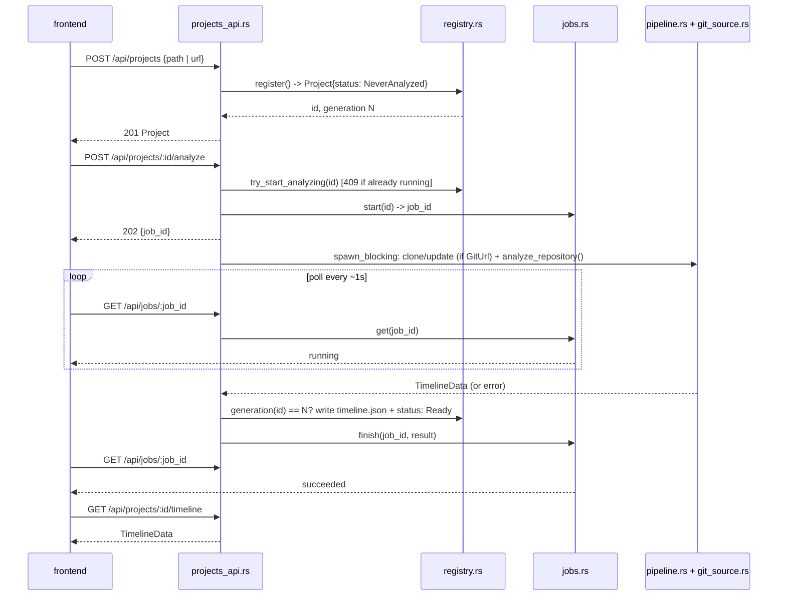

# Architecture

How this actually works, including the non-obvious decisions and why they exist. Written for whoever touches this next.

## System overview

`codevis` is one Rust binary (`codevis`) plus one static frontend bundle. The
binary runs in two distinct modes, both ending in the same wire format —
`TimelineData` — consumed by the same frontend code with no branching:

Both modes are one-shot analysis, not a watcher: nothing polls the repo for
new commits on its own. In legacy mode you re-run `analyze`; in multi-project
mode you click **refresh** (or `POST .../analyze` again), which re-clones
(git URL) or re-reads (local path) and re-analyzes from scratch.

## CLI (`src/main.rs`)

One `clap` binary, three subcommands, all thin wrappers over the modules
documented below — `main.rs` itself owns no analysis logic:

| Subcommand | Delegates to | Notes |
|---|---|---|
| `codevis analyze <repo_path> [-o timeline.json] [-v]` | `pipeline::analyze_repository()` + `exporter::export_json()` | One-shot, no server involved |
| `codevis serve [--data timeline.json \| --data-dir codevis-data] [--host] [--port]` | `server::run()` (legacy) or `server::run_multi_project()` (default) | Which one runs is decided purely by whether `--data` was passed — see "System overview" above |
| `codevis export <data.json> [--format html] [--frontend-build frontend/build]` | `exporter::export_html()` | Passes the input file's bytes through unparsed, so an export reproduces exactly what `analyze` wrote even from a `schema_version` this build predates |

`run_serve()` is also where `bootstrap_import_if_needed()` (see "Bootstrap
import" below) runs, exactly once, before the multi-project server starts
listening — never in legacy `--data` mode, since that path has no registry
to import into.

## Backend (`src/`)

- **`analyzer.rs`** walks commits via a `git2::Revwalk` from HEAD, diffs each commit against its first parent (an empty tree for the root commit), and tallies per-file add/delete line counts in a single `Diff::foreach` pass. Merge commits get the same treatment — their diff is against their first parent, same as a normal commit, so a merge that also contains its own file changes will show them.

  Two invariants here are load-bearing and easy to break by accident: the per-thread `git2::Repository` handles are scoped to the call via `map_init` rather than cached in a `thread_local!`, and the `Diff::foreach` line counts are correlated back to their delta by a hand-maintained index. Both have their own write-up in [`docs/solutions/`](solutions/) — read those before optimizing this function.

  `file_stats` keys its map by **full repo-relative path**. It used to key by basename, which merged every same-named file in the tree (`mod.rs`, `Dockerfile`) into one entry and never matched the full path the frontend looks up.

  Two more things happen in the same pass, both easy to miss reading only the wire format:

  | Concern | What happens | Why |
  |---|---|---|
  | **Co-authored-by crediting** | `co_author_regex()` matches every `Co-authored-by: Name <email>` trailer (case-insensitive key, GitHub's own convention) on a commit message via `parse_co_authors()`. `contributor_stats()`/`file_stats()` credit each one exactly like `commit.author` — same commit, same file, same weight. | Without this, a bot or pairing partner credited only via trailer (no commit of their own) is invisible everywhere — leaderboard, commit-log author dropdown, radial-tree avatar ring. |
  | **HEAD-relative `.gitignore` filtering** | `build_head_gitignore()` walks **HEAD's tree** (not the working directory — this also works for a bare repo) for every `.gitignore` blob, anchors each at its own directory, and builds one combined `ignore::gitignore::Gitignore` matcher used for every commit in the walk. A file matching it is dropped from `files_changed` before line counts are ever tallied. | Filtering against *each historical commit's own* `.gitignore` would keep counting a since-vendored dependency or generated-output directory for every commit before the ignore rule existed — the file mattered once, but shouldn't keep bloating stats just because it used to be tracked. |

  Both are covered by [`test-fixtures/contributor-parity.json`](../test-fixtures/contributor-parity.json), a single fixture consumed by both this file's Rust test and `frontend/src/lib/__tests__/as-of-parity.test.ts` — so the two independently-maintained aggregation implementations (Rust's whole-history stats, the frontend's `as-of` stats) can't silently drift on how they credit a co-author.

- **`pipeline.rs`** is `analyze_repository(repo_path, verbose) -> Result<TimelineData, String>` — the repo-path-to-wire-format pipeline, shared verbatim by the `analyze` CLI command and every server-triggered analyze job. No stdout writes beyond the optional `verbose` progress lines, no file I/O of its own, so a route handler can call it directly and decide independently whether/where to persist the result.
- **`exporter.rs`** assembles the JSON shape the frontend expects, stamps it with `metadata.schema_version`, and streams it to disk with `to_writer_pretty` rather than building the whole document as one `String`. `cumulative_files` is the live file count as of each commit, maintained by tracking a set across the fold. Its contract test pins the emitted key set against `frontend/src/types.ts`, which is otherwise a hand-maintained mirror with nothing enforcing agreement.
- **`server.rs`** is deliberately dumb: it re-reads the data file from disk on every `/api/timeline` request rather than caching, so re-running `analyze` while `serve` is up picks up the new data on the next browser refresh with no restart needed. Exposes two entry points, `run()` (legacy, single `/api/timeline` route) and `run_multi_project()` (mounts `projects_api::projects_router()` and falls back to the same static-asset `ServeDir`); both build their `Router` in a separate function from the one that binds a port, so tests drive either one with `tower::ServiceExt::oneshot` without opening a socket.
- **`github.rs`** parses a git remote (`git@github.com:owner/repo.git` or `https://github.com/owner/repo.git`) into an `owner/repo` slug, used to build the GitHub commit-API URL for avatar resolution (see "Contributor avatars" below). Anchored at the start of the string and restricted to GitHub's actual owner/repo charset deliberately — an earlier, unanchored version matched any host merely *containing* `github.com` (`evilgithub.com/a/b`, `https://host/github.com/a/b`), and that slug gets interpolated straight into a URL the browser then fetches.

## Multi-project backend (`registry.rs`, `jobs.rs`, `git_source.rs`, `projects_api.rs`)

This is the default `codevis serve` behavior: instead of one pre-analyzed
`timeline.json`, the server tracks any number of *projects* — each one a git
URL or a local filesystem path — analyzes them on request, and serves each
one's own `timeline.json` independently.

| Module | Owns |
|---|---|
| `registry.rs` | Durable project metadata: `Project { id, display_name, source, status, last_analyzed, history }`, persisted as `registry.json` under the data dir via temp-file-then-`rename` (a crash mid-write can never leave a half-written, unparseable registry) |
| `jobs.rs` | In-memory-only tracking of in-flight analyze jobs (`JobManager`, a `std::sync::Mutex<HashMap<...>>` — no `.await` under the lock, so no need for an async-aware mutex) so the frontend has something to poll mid-run |
| `git_source.rs` | Clone/refresh a `GitUrl`-sourced project by shelling out to the system `git` binary; URL validation and credential redaction (see below) |
| `projects_api.rs` | The REST surface (`/api/projects`, `/api/jobs/:id`) plus the `spawn_blocking` glue that runs an analyze job off the async runtime |

### Project status lifecycle

The last transition — `Analyzing → Error` on restart — is `Registry::load()`'s
own doing: no in-flight job can survive a process restart, and leaving a
project stuck `Analyzing` forever would wedge it, since
`try_start_analyzing()`'s test-and-set guard would then reject every future
retry too. It's downgraded to `Error { message: "Interrupted by server restart" }`
instead, which a refresh clears normally.

Every successful or failed run also appends an `AnalysisRun { started_at,
finished_at, outcome }` to that project's `history` (newest first, capped at
20 — a "did my last few refreshes work" log, not an audit trail), returned
as part of the normal project JSON and rendered by the project switcher's
history panel.

### Register → analyze → poll, end to end

**The generation check is the load-bearing line in that last exchange.**
`Registry.generations: HashMap<String, u64>` is bumped in-memory (never
persisted, never part of any API response) every time `register()` assigns
an id. A slug id gets *reused* when a project is deleted and re-registered
under the same display name — without the check, a slow analyze job started
against the *old* registration could finish after the delete-and-re-register
and silently overwrite the *new* project's freshly-registered, not-yet-analyzed
directory with a stale result. Comparing the job's captured generation against
the registry's current one at write time turns that race into a no-op instead.

### Credential handling

A `GitUrl` source may embed a credential (`https://TOKEN@github.com/...`) —
needed to clone/fetch a private repo. `git_source.rs`'s `redact_url()` masks
the userinfo segment (`https://***@...`) everywhere that URL could otherwise
leave the process: `Project::redacted()` (applied only at the HTTP boundary
in `projects_api.rs` — `Registry`'s own methods keep returning the real URL,
since the analyze pipeline needs it to clone) and every `git` failure message.
The unredacted URL is still written to `registry.json` on disk. See
[`SECURITY.md`](../SECURITY.md) for the full threat-model note.

`validate_git_url()` allow-lists URL schemes and rejects a leading `-` (so a
URL string can't be misread as a `git` flag), and every clone/fetch is
invoked as `git clone -- <url> <dest>` — the `--` stops option parsing as a
second line of defense. `Command::arg` never goes through a shell, so
shell-metacharacter injection is structurally impossible regardless.

### Bootstrap import

On first boot of multi-project mode (`./codevis-data` doesn't exist yet), if
a legacy `timeline.json` is found at the process's working directory, it's
imported as the first project — copied into place and marked `Ready`
immediately, skipping `analyze_repository()` entirely — so upgrading from
single-file mode doesn't lose visibility into already-analyzed data. See
`bootstrap_import_if_needed()` in `main.rs`.

## Wire format

Every JSON shape crossing the Rust/TypeScript boundary is **hand-mirrored**,
not code-generated: the `Serialize` structs in `src/exporter.rs`/
`src/analyzer.rs`/`src/registry.rs`/`src/jobs.rs` on one side, plain
interfaces in `frontend/src/types.ts` on the other, kept in agreement by
convention plus one enforcement mechanism per shape (below) — there is no
shared schema file generating both.

**`TimelineData`** — one project's full analyzed history, the payload behind
both `/api/timeline` (legacy) and `/api/projects/:id/timeline` (multi-project):

| Field | Shape | Notes |
|---|---|---|
| `metadata` | `{ schema_version, repo_name, github_repo, total_commits, total_contributors, total_files, date_range: {start, end} }` | `schema_version` is the version gate — see below |
| `timeline` | `TimelineEvent[]` (frontend: `CommitEvent[]`) | `{ timestamp, datetime, commit_hash, author, message, files_changed, lines_added, lines_removed, cumulative_lines, cumulative_files, co_authors }`, one per commit, oldest first |
| `contributors` | `Record<string, Contributor>` | Keyed by **display name**, not email — see "Known limitations" |
| `files` | `Record<string, FileStat>` | Keyed by **full repo-relative path**, not basename — see `analyzer.rs` above |

`src/exporter.rs`'s own contract test pins its emitted key set; nothing pins
the frontend side automatically, which is why `frontend/src/types.ts` says so
in a comment pointing back at this file.

**`SCHEMA_VERSION`** (currently `2`, bumped from `1` when `co_authors` was
added) is the only field this repo treats as a real compatibility gate.
`app-root.ts`'s `assertUsable()` is asymmetric on purpose: a file with **no**
`schema_version` at all (written before versioning existed) is accepted as
version 1, but a file whose version is **newer** than
`SUPPORTED_SCHEMA_VERSION` is rejected outright with a "rebuild the frontend"
message, rather than rendered half-empty because the renderer dereferences a
field that doesn't exist yet in an older build. Bumping the version is a
two-file change — `SCHEMA_VERSION` in `exporter.rs` and
`SUPPORTED_SCHEMA_VERSION` in `types.ts` — and CLAUDE.md calls this out as a
rule, not a suggestion.

**Multi-project shapes** (`Project`, `ProjectSource`, `ProjectStatus`,
`AnalysisRun`, `RunOutcome`, `Job`, `JobState` — all defined in `registry.rs`/
`jobs.rs`, mirrored in `types.ts`) are independent of `TimelineData` and carry
no `schema_version` of their own; they're the *metadata about* a project, not
project data itself, and the frontend always fetches the current shape live
rather than caching one from disk.

## Frontend (`frontend/src/`)

### App shell & shared playback/routing infrastructure

Everything in this section exists once and is shared by every view, as
distinct from `lib/file-tree.ts`/`lib/geometry.ts`/etc., which only
`timeline-viz.ts` uses:

| Module | Owns |
|---|---|
| `components/app-root.ts` | The shell: fetches/validates `TimelineData` (`assertUsable()`, above), owns the rAF-driven playback loop (`isPlaying`/`currentTime`/`maxTime`/`speed`), and mounts one of six view components keyed by `viewMode` |
| `components/project-switcher.ts` | Register/rename/refresh/delete a project; its own `idle → analyzing → ready → error` state machine per on-screen project, driven by re-polling `GET /api/projects` (not a one-shot job id) so resuming an already-in-flight analysis after a page reload works the same as watching one it just triggered itself |
| `components/view-switcher.ts` | The six-way tree/calendar/leaderboard/growth/treemap/commits selector |
| `components/scope-toggle.ts` | The all-time/as-of pill shared by every view that can show either whole-history totals or numbers scoped to `currentTime` (calendar, leaderboard, treemap, commit log) — one component so the choice of which is the honest default can't drift between them |
| `lib/route.ts` | The hash router: `#/<projectId>/<view>`, hand-rolled (`parseHash`/`formatHash`) rather than a router library, deliberately excluding `currentTime` so scrubbing doesn't spam `history.replaceState` |
| `lib/playback.ts` | Pure pacing math (`commitsPerTick`, `ticksPerSecond`, `advance`, `clampFrameDelta`) for the rAF accumulator loop, kept separate from `app-root.ts` so it's testable without faking `requestAnimationFrame`/`performance.now` |
| `lib/as-of.ts` | `contributorStatsAsOf`/`fileStatsAsOf`/`timelineUpTo` — recomputes contributor/file aggregates from a time-sliced `timeline` array, mirroring `contributor_stats`/`file_stats` in `analyzer.rs` field-for-field, for views showing "as of now" instead of the Rust-precomputed whole-history numbers |
| `lib/activity.ts` | `activityAsOf`/`fileFactsAsOf` — the same as-of-time slicing, scoped to a single path or path predicate, used by the radial tree's click-to-inspect panel |

### The other five views

`timeline-viz.ts` (the radial tree) is the original and most complex view,
covered in depth below. `app-root.ts` mounts one of six view components at a
time, all fed the same `.data` — a `TimelineData` — plus a shared
`currentTime`/`seek` playback contract via `lib/route.ts`'s hash router
(`#/:projectId/:view`). Each of the other five keeps DOM/Lit concerns in its
component and pushes anything that's a pure function of the data into its own
`lib/` module, same split as the tree:

| View component | Backing `lib/` module(s) | What it shows |
|---|---|---|
| `calendar-heatmap.ts` | `lib/calendar.ts` (`bucketByDay`, `calendarWeeks`, `intensityLevel`) | GitHub-style activity calendar — one cell per day, 4-5 discrete intensity levels |
| `contributor-leaderboard.ts` | `lib/contributor-stats.ts` (`buildLeaderboard`, `buildLeaderboardAsOf`, `sortLeaderboard`, `groupBotRows`) | Ranked bars per contributor, sortable by commits/lines/files, all-time or as-of-`currentTime` |
| `growth-chart.ts` | `lib/growth.ts` (`growthSeries`, `nearestIndexForTimestamp`) | Cumulative lines/files over time; a playhead line/dot tracks `currentTime`, and a pointer-down on the chart seeks to the nearest commit via `d3.pointer` + `nearestIndexForTimestamp` |
| `churn-treemap.ts` | `lib/treemap-layout.ts` (reuses `lib/file-tree.ts`'s cluster-collapsing so node count stays bounded the same way the radial tree's does) | File tree as nested rectangles, sized by churn (lines touched) or edit count |
| `commit-log.ts` | `lib/commit-table.ts` (`filterCommits`, `sortCommits`) | Sortable, filterable, searchable commit table — message/file substring match, per-author filter |

All five share `lib/contributor-color.ts` (`contributorColorScale`) with the
radial tree, so the same contributor gets the same color in the tree, the
leaderboard's bars, and the commit log's author badges — extracted from what
used to be `timeline-viz.ts`'s own inline `d3.scaleOrdinal`.

### Bot/AI-contributor grouping

`lib/bot-authors.ts`'s `isBotAuthor(name)` recognizes GitHub Apps
(`[bot]`-suffixed), any Claude model variant (`/^claude\b/i`), and a small set
of known named AI tools (Copilot, Codesmith, ChatGPT/GPT-*, Codex, Cursor,
Devin, Gemini, Jules) — matched case-insensitively against the exact
contributor name the backend already resolved (including anyone credited only
via a `Co-authored-by:` trailer, see above).

Three independent surfaces apply the same grouping, each defaulting to
**grouped** and each exposing a `<bot-group-toggle>` (shared component,
`bot-group-change` custom event) to flip to individual per-bot entries:

| Surface | Grouping applied via | What collapses |
|---|---|---|
| `contributor-leaderboard.ts` | `groupBotRows()` (`lib/contributor-stats.ts`) | Every bot row folds into one synthetic `{ author: 'Automated', mergedAuthors: [...] }` row, sized by the sum of its members' stats |
| `commit-log.ts` | Inline `isBotAuthor` filter on the author dropdown + per-row label | The author filter offers one "Automated" option instead of N bot names; selecting it matches any bot-authored commit |
| `timeline-viz.ts` | `displayAuthor()`/`colorForAuthor()`/`displayAuthors()` helpers | Bot contributors share one avatar in the ring, one spark-stroke color, and fold into the inspector's "Contributors" count/list the same way |

"Automated" is never a key in `data.contributors`, so it has no earned place
in the per-author `d3.scaleOrdinal` domain — every surface uses a fixed
violet (`var(--bloom, #c792ff)`) for it instead of asking the color scale to
invent one, which is also what visually ties the toggle itself to the rows/
avatar it affects. `groupBotRows()` and the leaderboard/commit-log both list
which *actual* bot names are folded into a given "Automated" entry (a
`mergedAuthors` field, or a hover title) rather than hardcoding a static
list — grouping is driven entirely by `isBotAuthor()` classification, never
by which names happen to appear in one particular repo's data.

### Module split

`timeline-viz.ts` owns DOM, canvas, and Lit lifecycle — nothing else. Everything that is a function of its inputs lives in `lib/` so it can be unit tested without a browser:

| Module | Owns |
|---|---|
| `lib/file-tree.ts` | Path tree construction, cluster collapsing, `resolveFilePath` |
| `lib/geometry.ts` | Polar/cartesian projection, link arcs, ring declutter, size tiers, reveal-count search |
| `lib/tree-layout.ts` | `computeTreeLayout()` — the full d3 hierarchy, radial layout, depth rescale, and weight scales |
| `lib/github-avatar.ts` | Avatar resolution and its opt-out |
| `lib/identicon.ts`, `lib/md5.ts` | Offline and Gravatar avatar fallbacks |

The reveal-count binary search lives in `geometry.ts` next to nothing else it needs, because it has to agree exactly with the forward cursor walk in the component: scrubbing backwards must land on the same revealed set as playing forwards to that instant, and that invariant is a test, not a comment.

### Why canvas, not SVG, for the tree

The first version rendered every file/directory as an SVG `<circle>`. That works fine for small repos but falls over for anything with thousands of files: SVG's cost is dominated by DOM node maintenance (style recalc, layout), not draw cost, and it *accumulates* — by the end of playback on a 14k-file repo you'd have 14k+ live elements sitting in the DOM forever, and every animation frame got slower as more of them appeared.

`timeline-viz.ts` splits rendering into two layers:
- A `<canvas>` for the tree itself (nodes + links). Canvas repaints instead of accumulating a persistent element tree — a full redraw of tens of thousands of circles is a few milliseconds of `fillRect`/`arc` calls, not a DOM problem.
- An `<svg>` overlay, `pointer-events: none` except where explicitly needed, for the small number of things that benefit from real DOM elements and CSS transitions: contributor avatars and the transient "spark" bursts when a commit lands. These stay in the low single digits regardless of repo size, so SVG's per-element cost never matters there.

### Why the tree is a radial layout, and the two rescales layered on top of `d3.tree()`

`d3.hierarchy()` + `d3.tree()` gives you `(angle, radius)` per node. Two things about the default output don't work at scale:

1. **Depth is spaced linearly** — every tree level gets an equal radial band regardless of how many nodes live there. A repo where thousands of files sit 3-4 levels deep crams them onto one tight inner ring no matter how big the total radius is. Fixed by re-deriving each depth's radius from *cumulative node count up to that depth* (`radiusAtDepth = radius * sqrt(cumulativeCount / totalCount)`), so dense levels get pushed out to where the circumference — and therefore the room — is actually bigger.

   Pure count-based spacing has its own failure mode: a shallow level with few nodes (a handful of top-level directories) gets squeezed to a tiny fraction of the radius just because deep levels dominate the total leaf count — even though it's the first branching point and every one of those branches' links has to *start* there. Near the pole, angular separation alone can't create real physical separation (arc length → 0 as radius → 0), so that's exactly where the visual becomes a dense knot no matter how well later rings are spaced. Fixed with a depth-based floor, independent of node count: `radiusAtDepth = radius * max(sqrt(cumulativeCount/total), 0.5 * sqrt(depth/maxDepth))`. Both terms are monotonic in depth so the max is too — no risk of a deeper ring ending up inside a shallower one.
2. **`separation()` only shapes spacing *relative to siblings*** — it doesn't guarantee an actual minimum pixel gap between any two nodes on a ring, including across different branches. Fixed with `declutterRing()`: walk each ring in angular order and push nodes apart (with wraparound handling so it can't spiral past 2π) until every adjacent pair clears a real minimum gap, sized off the current weight scale.

Links aren't straight cartesian lines between two points either — `radialArcPoints()` interpolates `(angle, radius)` *linearly in polar space* and samples a few points along that before projecting to `(x, y)`. That's what gives the tree its characteristic gentle arcs instead of spokes; a straight interpolation in polar space is a curve once projected, because the projection itself is nonlinear.

### Clustering: why files disappear into "N files" nodes

A convention like a 500-line file cap pushes a codebase toward many small files per module rather than a few large ones — that's a policy artifact, not something about the codebase's actual shape, and rendering every one of those files as its own node just adds noise that has nothing to do with what's interesting about the repo's history.

`lib/file-tree.ts` collapses a directory's file children past `CLUSTER_THRESHOLD` (8) into one or more aggregate nodes — not necessarily one. Dumping every over-threshold file into a single blob loses information the moment a directory holds more than one *kind* of thing: a module's `.rs` implementation, its own `_test.rs`, and an unrelated pile of `.md` docs read as one undifferentiated "47 files" node either way. `lib/file-similarity.ts`'s `groupBySimilarity()` unionfinds files within one directory (never across directories) by a blended score — co-change coupling (Jaccard over which commits touched each pair together, weighted highest: two files genuinely edited together most of the time they're edited at all is the strongest relationship signal a git history can offer), shared extension, and shared name stem (`foo.ts`/`foo.test.ts`, `foo.rs`/`foo_test.rs` — common test-suffix patterns stripped before comparing). None of the three secondary signals is enough *alone* to cross the grouping threshold — only combinations, or coupling on its own above a high bar — because grouping is transitive: a lone "shares an extension" trigger would fuse any two otherwise-unrelated same-extension pairs elsewhere in the directory into one group the moment a third file bridges them (bit an early version this way — `auth.rs`/`auth_test.rs` and `db.rs`/`db_test.rs`, two clean unrelated pairs, fused into one four-file group because `auth.rs` and `db.rs` shared nothing but an extension, which alone was enough to link them). Files that don't match anything nearby stay as individual nodes if there are few enough left over; otherwise they still get bundled into one catch-all cluster (named from their shared extension if they have one) so a directory's rendered child count stays bounded regardless of how well individual files happened to group — verified on video-editor: 231 clusters across 51 directories that used to each collapse into a single blob, no draw-time cost (`drawCanvas()` doesn't care how many clusters exist, same as it doesn't care how many colors do).

The one subtlety carried over from the original single-cluster design: a cluster from a child directory is itself already an aggregate, not a plain file — if it were counted toward the *parent's* file threshold too, one file-heavy branch anywhere in the tree would cascade into absorbing every other cluster up to the root (this happened during development: a single generated-output directory with 9,597 files caused 11,000+ of the repo's 14,093 files to collapse into one meaningless top-level blob). The fix is that `collapseClusters()` treats prior clusters like directories, not like files, when computing a level's own threshold.

A second, independent decluttering mechanism sits at the *rendering* layer: `sizingFor()` sets a `fileZoomThreshold` per repo-size tier, and individual (non-cluster) file nodes simply don't draw below that zoom level — only once the user has zoomed in enough that they'd have actual room. Clusters are exempt from this gate since they're already the aggregate.

### Deleted files leave the animation, not just the working tree

Every node the tree ever introduces stays in the layout forever — `introducedAt`-based reveal is purely additive, and pruning the tree structure per scrub position isn't necessary (or worth the complexity) since visibility is already a draw-time concern, not a structural one. A file's final DELETE delta sets `TreeNode.removedAt` to that commit's index in `buildRawTree()`; a later re-add at the same path clears it, so only the file's state as of the timeline's last commit governs whether the animation shows it — a delete-then-re-add earlier in history is invisible to this (a deliberate simplification, not tracked per-interval).

Directories and clusters cascade the same rule bottom-up in `collapseClusters()`: a directory is alive as long as *any* child under it still is, and only goes dark once every child has its own `removedAt` (the max of them). One surviving file anywhere in a subtree keeps the whole chain above it visible — an empty directory isn't something git tracks, and the animation shouldn't invent a moment where one "existed." The repo root is force-exempted from this cascade (`buildFileTree()` clears it explicitly) so the hub marker never disappears even in the degenerate case where literally everything has been deleted.

The renderer's `isRemoved(node, currentTime)` — `removedAt !== undefined && currentTime > removedAt`, not `>=` — governs the click hit-test and the selection ring, and is where the node stops counting as "solid" in the main draw loop. The `>` rather than `>=` matters: it keeps a file visible (and clickable, and spark-targetable) through the commit that deletes it, so its "last stand" still shows up in the animation and a spark landing on it that same tick lands somewhere that's actually drawn.

It doesn't just vanish at that point, though — it dissolves. `timeline-viz.ts` walks `nodesByRemoval`/`removalTimes` (the removal mirror of `nodesByIntroduction`/`nodeIntroductions`, same cursor-and-binary-search pattern) to find nodes within `glowWindow` commits of their `removedAt`, and draws them shrinking and fading over that window — the visual inverse of the "just arrived" glow on introduction. That per-node walk is bounded (only the small recently-removed set, never the whole tree), but the actual *drawing* is bucketed into a handful of discrete `REMOVAL_STAGES` (alpha/radius-scale pairs) rather than one `beginPath()`/`fill()` call per node, for the same reason `linkTiers` exists: canvas draw-call state (fillStyle, in this case) can't vary within one batched path, so a commit that deletes thousands of files at once (`rm -rf vendor/`) would otherwise cost thousands of individual draw calls every frame for the whole fade window. A handful of stages keeps it to a handful of batched calls regardless of how many nodes are dissolving simultaneously.

### Weighting: size and opacity as information, not decoration

Every node/link carries a `touches` count (how many commits touched it). Node radius is a `d3.scaleSqrt()` off that count — computed once at layout time, applied per-node for free inside the same batched canvas path (radius can vary per `arc()` call at zero extra cost). Links can't do that as cheaply: `strokeStyle`/`lineWidth` are canvas *state*, not per-call, so link weight is quantized into a small number of discrete tiers (each tier is one `beginPath()`/`stroke()` pair) instead of a continuous scale.

The practical effect: rarely-touched files shrink toward invisible instead of adding uniform clutter, and hot spots visually pop. This is also what makes deep-zoomed dense areas (e.g. near the root, where branches converge) somewhat more legible than uniform dots would be — though it doesn't fully solve convergence-point density; that's a structural property of any single-root radial layout, not something size/alpha tuning fixes.

### Branch coloring: hue per node, not per ring

Earlier versions derived hue from `(top-level branch index, depth)` alone — every node at the same depth within the same top-level branch shared the *identical* color, so two unrelated sibling subtrees (e.g. `src/a/**` and `src/b/**`) rendered indistinguishably, reading as concentric depth "rings" rather than as separate branches. Hue is now built from three independent terms, summed:

1. **The node's own angular position** (`n.x` from the d3 radial layout, converted to degrees). d3.tree() already partitions the full circle recursively — every subtree occupies a disjoint angular wedge, sized by its own extent, at *every* depth, not just the top level — so this term alone separates unrelated lineages for free, with no separate partition to compute or keep in sync with the layout.
2. **A fixed step per depth level** (`BRANCH_HUE_STEP`, 11°, added once per level, never resetting). Angular position alone isn't enough: a straight, unbranching chain (a single child at every level) keeps the *exact same* angular position all the way down, since there are no siblings to spread apart, which would otherwise collapse the whole chain to one hue. This term guarantees the next child down is always visibly different from its parent even along a chain with no branching at all — video-editor's deepest real chain is 10 levels and all 10 are pairwise-distinct colors, verified in a browser.
3. **A fixed spread keyed on plain sibling index** (`SIBLING_HUE_SPREAD`, 60°, divided by sibling count). Term 1 alone doesn't guarantee siblings are *far enough* apart to survive HSL→RGB's rounding to an integer 0-255 triplet: a directory with many subdirectories crowded into a narrow wedge can have siblings whose angular positions differ by a fraction of a degree — a real gap, but too small to change the rounded pixel color. Indexing this term purely on "which child is this, out of how many" (not on the layout's actual geometry) guarantees a minimum separation between any two siblings regardless of how tightly the layout happened to pack them.

Lightness and saturation still step toward a floor/ceiling per depth level and hold there once reached (they can't keep stepping forever without going full black or fully gray) — depth's role is shading "further down the trunk," while hue carries per-node/per-lineage distinctness. On top of the depth trend, a second axis — `vibrancy`, a deterministic 0..1 value derived from `hueUnits % VIBRANCY_MODULUS` (a prime unrelated to any of the hue terms, so it doesn't just echo the hue pattern) — pushes saturation and lightness independently of depth: high vibrancy means near-max saturation and a punchier, lower lightness (neon); low vibrancy means low saturation and high lightness (pastel). Without this, every node at a given depth shared the same "shade of the branch" regardless of which node it actually was — depth alone reads as a smooth gradient, not real variety. Since vibrancy is a pure function of `hueUnits`, which was already part of the batching key, it doesn't add a new dimension to `branchBucket` — the same nodes that shared a bucket before still do.

All of this is computed once in `computeTreeLayout()`, stored as `TreeNode.colorRgb` (an `[r,g,b]` triple, so the draw loop can build `rgba(...)` strings with whatever alpha that pass needs), `TreeNode.branchDepth` (how many levels below its branch root, exposed separately so the renderer can taper link width/alpha with depth without decoding it back out of the bucket key), and `TreeNode.branchBucket` (`hueUnits * 1_000_000 + branchDepth`, where `hueUnits` is the fine-quantized (0.01°) sum of the hue terms — an opaque grouping key, not a small bounded integer; every node sharing a bucket has the *identical* color).

The reason for `branchBucket` at all: giving every node its own distinct color is fundamentally in tension with the batched-draw-call optimization the renderer otherwise relies on (see "Weighting" above and `docs/solutions/` — canvas `fillStyle`/`strokeStyle`/`lineWidth` are draw-call *state*, not per-shape, so one node in five different colors would mean five individual `fill()` calls instead of one batched pass over five nodes). `drawCanvas()` resolves this the same way `REMOVAL_STAGES` already does for fade-out: bucket revealed nodes by `branchBucket` (and separately by dir/file, since files also gate on the zoom threshold) into `Map<number, PointNode[]>`s — a `Map` rather than a pre-sized array, since the number of distinct buckets a tree needs isn't known or bounded in advance — then issue one batched `fill()`/`stroke()` per non-empty bucket. On video-editor's tree (2600 commits, 15k files, 3100+ revealed nodes at full playback) that's over 2000 distinct colors and still ~0.9ms median for `drawCanvas()` alone, because the *scan* itself stays bounded to the revealed node count, only the number of batched `fill()` calls grows. Links use their target node's color, and taper (thinner, more transparent, clamped so a very deep link never vanishes) with `branchDepth`, so a connection reads as more structurally prominent near the trunk than at a twig tip. The dissolve pass (previous section) reads the same `colorRgb` so a fading node fades using the color it was actually drawn in, not a flat fallback.

The root itself has no `colorRgb`/`branchDepth`/`branchBucket` — it isn't part of any branch — and keeps its own fixed hub-marker color.

### Contributor avatars

Resolved in `lib/github-avatar.ts`, in order of confidence, each one verified before being trusted:

1. **`users.noreply.github.com` email** — the username is literally embedded in the address (`{id}+{username}@...` or `{username}@...`). No network call.
2. **GitHub's commit API** (`GET /repos/{owner}/{repo}/commits/{sha}`) — the same account-resolution mechanism GitHub itself uses to attribute a commit or PR to a profile (`.author.login`). Only reachable for public repos without an auth token; private repos 404 here and there's no client-side way around that.
3. **The git author's display name as a candidate username** — many people's git `user.name` genuinely is their handle. Only accepted if `github.com/{name}.png` actually loads a real image (checked via `Image().onload`, cached) — never shown speculatively, since a wrong guess would show a stranger's photo.
4. **Gravatar identicon** (MD5 of the commit email) — the same fallback GitHub itself displays for unlinked commit authors. Always available, used as both the instant-paint placeholder while 1-3 resolve asynchronously and the final fallback.

`lib/md5.ts` is a from-scratch MD5 implementation (Web Crypto only exposes SHA), covered by `lib/__tests__/md5.test.ts` against the RFC 1321 vectors.

All of this is opt-out: `?avatars=local` on the page URL skips every third-party request and renders a deterministic offline identicon (`lib/identicon.ts`) instead. Worth using when analyzing a private repository — the default path sends an MD5 of each commit author's email to Gravatar and the repository slug to GitHub.

### Click-to-inspect

Canvas has no DOM to attach listeners to per-node, so `handleCanvasClick()`/`handleCanvasDblClick()` share `hitTestNode()`: convert the click's screen coordinates through the inverse of the current zoom/pan transform into the same local coordinate space everything is drawn in (`screenToLocal()`), then linear-scan currently-revealed nodes for the nearest one within its rendered radius. This is a per-click cost, not a per-frame one, so a linear scan over even tens of thousands of nodes is fine.

Clicking a cluster ("N files") shows a scrollable list of its currently-live members, each clickable into its own time-scoped detail view (`lib/activity.ts`'s `fileFactsAsOf()`) — capped at `MAX_CLUSTER_MEMBERS_SHOWN` (200) since a cluster can aggregate thousands of files and nobody's scrolling through 4,000 filenames. A cluster member's individual `TreeNode` is dropped once `collapseClusters()` folds it into the aggregate (see "Clustering" above), so it has no entry in `layout.nodeByPath` and no laid-out position — `fileFactsAsOf()` reads its introducedAt/removedAt/activity straight from the raw timeline by path instead, which is also why it works regardless of whether that particular directory happens to be clustered or expanded.

Double-clicking a cluster adds its owning directory's path to a `Set<string>` (`expandedClusters`, component state, keyed by path so it survives rebuilds) threaded through `computeTreeLayout()` → `buildFileTree()` → `collapseClusters()`, which skips the cluster-threshold check entirely for any directory in that set — every file renders individually regardless of count. `d3.zoom()` binds double-click-to-zoom-in by default; that's explicitly unbound (`.on('dblclick.zoom', null)`) so double-click means "expand" unambiguously rather than fighting the zoom behavior.

## Known limitations worth knowing about before "fixing"

- **Root-adjacent density** was a real problem on very large repos (all branches converging through a near-zero-radius region) — fixed via the depth-floor described above. Worth re-checking on any future repo with a much deeper or much wider tree than what's been tested so far (a handful, up to ~14k files).
- **Rename detection is not enabled.** `diff_tree_to_tree` is never followed by `find_similar`, so git reports a rename as a separate delete plus add. Consequences: the `RENAME` and `COPY` arms of `change_type_name` are unreachable, a renamed file's line count is charged twice, and its history splits into two nodes in the tree. Enabling it costs a similarity scan per commit on the hot path. Left off deliberately — but it is a choice, not an oversight, so measure before assuming either way.
- **Merge commits are counted against their first parent only**, which double-counts every line merged in: once on the branch commit that introduced it, once on the merge. This is `git log --first-parent` semantics and is deliberate. On this repo it is the difference between codevis reporting 8907 added lines and `git log --no-merges --numstat` summing to 8750.
- **Contributors are keyed by display name, not email.** Two people sharing a name merge into one record carrying one of their email addresses; one person committing under two names appears twice. Keying by email would fix the first and worsen the second for anyone who changes machines. Co-authored-by crediting inherits this: a bot or person credited under a different display name than their primary commits (e.g. `Claude` on one machine, `claude[bot]` via trailer on another) shows up as two separate contributor records rather than one — `isBotAuthor()`'s grouping (see "Bot/AI-contributor grouping" above) papers over this for the common bot-naming cases, but doesn't fix the underlying keying choice for humans in the same situation.
- **Gitignore filtering is HEAD-relative, not per-commit-historical.** A file matching HEAD's current `.gitignore` is excluded from *every* commit's stats, including ones from before that ignore rule existed. This is deliberate (see "HEAD-relative `.gitignore` filtering" above) but means total historical line counts can shift the moment a `.gitignore` entry is added or removed, even with no code change.
